# `/explain` は何を実行し、どこで止まるのか

想定読者：レビュー前に今回の入口と納品経路を理解したい依頼者。依頼文で分かるのは Markdown・HTML を cmux で受け取り、解説をレビュー前の段階に置きたいこと。Pi の内部知識や職歴は仮定しない。\
省いたもの：一般的な VCS・AI ツールの入門、全設定の列挙、行単位のコード解説、Claude 側の詳説。\
所要時間：約 5 分。Pi の呼び出し経路を中心に、流れ・変更点・検証範囲を追う。\
検証方法：実行済みのローカル prompt loader probe、既存の focused Bats tests、explainer の図・文書検査。確認した範囲を越えて全体の正しさは保証しない。

伝えたいこと：`/explain` は既存 explainer への再利用可能な prompt 入口であり、テンプレート展開後の作成・検証・cmux 表示は AI への指示で進む。セクションは 1. 一枚で範囲をつかむ、2. 呼び出しと変更前後、3. 根拠となる検査、4. 読み順と再現手順。

| 節                | 役割                                                 | 見せるもの       | なぜ                               |
| ----------------- | ---------------------------------------------------- | ---------------- | ---------------------------------- |
| 一枚で            | 自動処理と依頼先の役割を切り分ける                   | 要約表           | 入口をパイプラインと誤認しないため |
| 1. 呼び出し       | Pi の設定から共有 prompt、skill、cmux 表示までを追う | フロー図、実出力 | 関係する変更箇所を結びつけるため   |
| 2. 確認できた範囲 | loader probe と既存テストが示す範囲・限界を示す      | 実行結果         | 検証を過大解釈しないため           |
| 3. 読む・再現する | 次に確認するファイルと最小再現方法を示す             | 読み順、コマンド | 自分で根拠を辿れるようにするため   |

## 0. 一枚で

| 観点       | 要点                                                                                                              |
| ---------- | ----------------------------------------------------------------------------------------------------------------- |
| 呼び出し   | Pi が登録済み prompt template を展開し、引数をテンプレートへ渡す。                                                |
| 実際の作業 | 展開された文章を読んだ agent が explainer skill の手順で資料を作成・検証し、呼び出し元の cmux で HTML を開く。    |
| 停止点     | 表示後に終了する設計。自動コードレビューは起動しない。文章の指示は OS の権限や sandbox を強制する仕組みではない。 |
| 読み方     | `/explain` が「何を直接行うか」と「agent に何を頼むか」を分けて追う。                                             |

変更前も、自然言語や `/skill:explainer` で資料を依頼できた。変更後は `/explain [対象・重点]` という専用入口が加わり、同じ共有 prompt を Pi と Claude の command 入口から参照する。これは新しい実行プログラムや review trigger の追加を意味しない。

Pi では更新後に `/reload` を一度行い、`/explain` または `/explain 認証処理をエラー時の流れ中心に` と入力する。対象は引数、会話中の実装範囲、作業コピーの差分の順に決まり、曖昧なら質問する。

## 1. 呼び出しは「展開」と「指示された作業」に分かれる

Pi の `settings.json` にある `prompts` が共有 prompt ディレクトリを登録する。そこにある `explain.md` が `/explain` の本文であり、`$ARGUMENTS` を含む指示文を Pi の prompt template loader が展開する。Claude 側は同じファイルへの相対 symlink で、内容を複製していない。

<!-- source: ../../../pi/agent/settings.json -->

```json
"prompts": ["~/.agents/skills/explainer/prompts"]
```

<!-- source: ../../../skills/explainer/prompts/explain.md -->

```markdown
---
description: "実装の変更と仕組みを理解するための解説資料を作る（レビューはしない）"
argument-hint: "[対象・重点]"
---
```

展開後の文章は `explainer skill` の通常手順を使うよう agent に依頼する。skill が Markdown を保存し、HTML を構築・検証し、caller の cmux workspace で開く流れを指示するが、これらは prompt を展開しただけで OS が実行・強制する処理ではない。

<!-- source: ../../../skills/explainer/prompts/explain.md -->

```markdown
納品後は終了します。parallel-review、reviewer API、修正、commit、push、PR
を開始しません。「レビュー前」はレビュー実行の許可ではありません。
```



図は Pi 設定・共有 prompt・skill の記述をもとに手で整理した概念図で、機械的な制御フロー解析ではない。辺の事実シートは `figures/flow.facts.json` にあり、内容が実行時に強制されるという意味ではない。

loader probe は、ローカルに導入済みの Pi の loader を直接読み、登録名・argument hint・引数展開と Claude alias の実体を確認した。これはこのインストール版の内部 loader API を使った診断であり、全 Pi リリースの安定 API や Claude の live UI を保証しない。

<!-- output: prompt-flow -->

```
registered: /explain [対象・重点]
expanded: no arguments, src/auth.ts, quoted path + focus
Claude alias: same canonical file
```

## 2. 何を確かめ、何を確かめていないか

loader probe は、引数なし・通常の対象 `src/auth.ts`・空白を含む引用符付き対象と重点文を展開できること、Claude alias が共有 prompt と同じ実体を指すことを assertion で確認した。prompt の作業指示を実行したり、agent が従うかを測ったりはしない。

既存の focused Bats tests は document verifier の出力・失敗判定などと Pi の共有 skill listing の既存挙動を確認する。新しい prompt の文章品質や agent の遵守、cmux が実際に表示できるかはこのテストからは分からない。

<!-- output: focused-tests -->

```
1..10
ok 1 checks success and rejects output mismatch
ok 10 fails when an immediate skills directory lacks SKILL.md
```

したがって、検証済みという言葉はこの資料に載せたコマンド・図・引用の整合性を指す。テンプレート展開や文書検査は、生成物の内容全般の正確さ、レビューを開始しないことの強制、表示先 cmux の状態を証明しない。

## 3. ファイルを読む順と理解度チェック

Pi 経路を追うなら `pi/agent/settings.json` → `skills/explainer/prompts/explain.md` → `skills/explainer/SKILL.md` の順に読む。Claude の入口は `claude/commands/explain.md` で、共有 prompt への symlink であることだけ確認すればよい。

### 理解度チェック

1. `/explain` の呼び出しで自動的に起きる処理と、agent に依頼される処理は何が違う？
2. Pi 設定・共有 prompt・skill・cmux は、どの順に関係する？
3. loader probe の成功だけでは、なぜ agent がレビューしないことや cmux 表示の成功を結論できない？
4. focused Bats tests の成功が示す範囲と、示さない範囲は何？

<details>
<summary>答え</summary>

1. Pi は prompt template を登録・展開する。資料作成、検証、cmux 表示は展開後の文章を読んだ agent が指示に従って行う。
2. Pi の設定が共有 prompt directory を登録し、prompt が explainer skill の利用を依頼する。agent が資料を作成・検証した後、caller cmux で HTML を開く。
3. probe はローカル loader の登録・展開・symlink の実体を確認するだけで、指示遵守を実行していない。文章の指示は OS の強制権限でもなく、cmux の表示試験も含まれない。
4. 指定された既存テストの対象挙動を確認するが、新しい prompt の文章や agent の遵守、cmux 表示を検査していない。

</details>

## 付録：再現

以下は repo root で実行する。prompt probe の loader は `npm root -g` でローカルに探索し、ネットワークや provider を初期化しない。

```sh
PI_PROMPT_LOADER="$(npm root -g)/@earendil-works/pi-coding-agent/dist/core/prompt-templates.js" node docs/explanations/explain-command/examples/prompt-flow.mjs
bats skills/explainer/tests/verify-doc.bats pi/agent/tests/list-shared-agent-skills.bats
EXPLAINER_RUNTIME="$HOME/.agents/skills/explainer/runtime" bash skills/explainer/scripts/run.sh verify docs/explanations/explain-command --write
```

| ファイル                                                            | 役割                                                    |
| ------------------------------------------------------------------- | ------------------------------------------------------- |
| `figures/flow.facts.json` / `figures/flow.mmd` / `figures/flow.svg` | 図の手動事実シート、Mermaid ソース、生成 SVG            |
| `examples/prompt-flow.mjs`                                          | インストール済み Pi loader と Claude alias を読む診断例 |
| `checks.json`                                                       | 文書検証で再実行するローカルチェック                    |
| `dist/index.html`                                                   | README から生成する保存済み HTML                        |
| `.gitignore`                                                        | この資料の生成 HTML・reader 作業物だけを除外            |
