# EventEmitter は同期、microtask はその後

**想定読者:** JavaScript と Promise は知っているが、`emit` と listener の順番に少し迷う人。これはデモ用の合成読者像で、実在するユーザーのプロフィールではない。

## 要点

`emit()` は登録済み listener をその場で順に呼びます。listener が `queueMicrotask` を登録しても、その処理は現在の同期コードが終わるまで待つため、残りの同期出力 `handled: true` と `after` の後に表示されます。`emit()` の `true` は listener が呼ばれたことを示します。



## 実行した根拠

Node.js v24.12.0 の公開 API と実装: [events.js](https://github.com/nodejs/node/blob/v24.12.0/lib/events.js)。ここでの具体的な順序は、次の小さな例を実際に実行した結果です。

<!-- source: examples/order.mjs -->
```js
import { EventEmitter } from 'node:events';

const emitter = new EventEmitter();
emitter.on('ready', () => {
  console.log('listener');
  queueMicrotask(() => console.log('microtask'));
});

console.log('before');
console.log(`handled: ${emitter.emit('ready')}`);
console.log('after');
```

<!-- output: event-order -->
```text
before
listener
handled: true
after
microtask
```

## 理解チェック

1. `listener` は `emit()` が戻る前と後のどちらで動く？
   <details><summary>答え</summary><p>戻る前。EventEmitter は listener を同期的に呼びます。</p></details>
2. `microtask` が `handled: true` より後になるのはなぜ？
   <details><summary>答え</summary><p>microtask は現在の同期処理の後に実行されるからです。</p></details>
3. `emit()` の `true` は何を示す？
   <details><summary>答え</summary><p>イベントに listener があり、少なくとも 1 つ呼ばれたことを示します。</p></details>

## 再現

リポジトリのルートから、次のコマンドで図と HTML を再生成して検査します。初回の依存導入だけは `skills/explainer/scripts/run.sh setup` を明示的に実行してください。

```sh
skills/explainer/scripts/run.sh verify skills/explainer/examples/event-emitter --write
```

`VERIFIED` はこの例の出力・引用・図・HTML の検査範囲を表します。結果は `dist/index.html` に保存されます。

このデモはこの例での実行順だけを示し、非同期処理全般の順序、複数イベントの挙動、実アプリケーションの性能までは証明しません。
